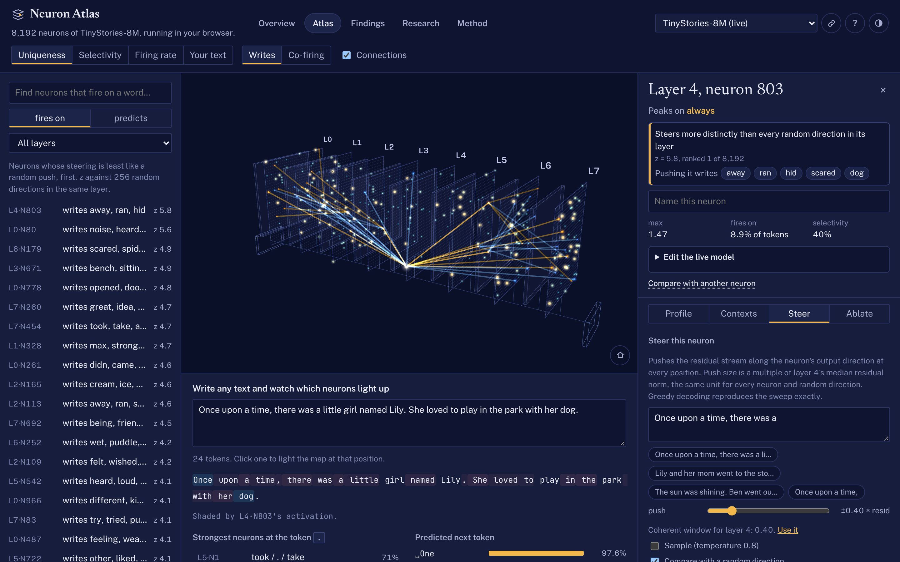

# Neuron Atlas

An interactive map of all 8,192 MLP neurons in a small language model, with a steering sweep of every one of them measured against random-direction controls. The model runs live in your browser. You can browse the neurons, see what each responds to, steer or ablate them, and replay every finding token for token. No server or GPU is needed.



The method follows [lyramakesmusic/neuron-explorer](https://github.com/lyramakesmusic/neuron-explorer), a steering-first explorer for Qwen3.5-4B that needs a GPU and a local server. Neuron Atlas uses the same workflow at portfolio scale. [TinyStories-8M](https://huggingface.co/roneneldan/TinyStories-8M) has 8 layers × 1,024 MLP neurons, small enough to sweep exhaustively on a laptop CPU and to run fully client-side.

## Findings

Every neuron was pushed along its output direction on three story prompts and from scratch, at the largest push its layer tolerates. 256 random directions per layer were pushed the same way. A neuron counts as a find only when the words it writes beat what random pushes write. The full log, with charts and live replays, is on the site's **Findings** page.

**Neurons**

| Neuron | What a push writes |
|---|---|
| L6·N179 **The villain** | A scary spider, and at larger pushes “a big, mean-looking man… scared all the other people”. The nearest thing this model has to an “evil” neuron. |
| L7·N756 **Something bad happens** | “Suddenly, a naughty thief stole all of her money!” Pushed the other way, the story stays sunny. |
| L4·N803 **Run and hide** | The top-scoring neuron in the model: a threat appears, and the hero is scared, runs and hides. |
| L5·N722 **The bully** | “A big, mean cat named Max. This cat liked to take other animals' toys.” |
| L2·N109 **The moral** | “She felt sad and wished she had been more careful.” |
| L0·N80, L4·N877 **Suddenly, a loud noise** | The same startle beat from two neurons four layers apart. The second one adds “It was a big, scary monster.” |

**Observations neuron-explorer did not report**

- **Counting words is not evidence.** By a naive “repeated word” test, 78% of random directions look themed, and so do 75% of neurons. Only 41 neurons (0.5%) beat all 256 random directions in their layer. In layer 5, none does: a random direction that writes a juicy apple and then “a big, mean wolf” outscores them all.
- **In a story model, neurons steer plot beats.** The strongest neurons write narrative moves (threat and flight, misfortune, regret, resolution, startle) rather than topics. This is a reading of the rollouts, not a measured category.
- **The middle layers are the fragile ones.** Text stays coherent under random pushes of 0.8× the residual norm at layers 0, 2 and 7, but only 0.4× at layers 4–5. The push size must be calibrated per layer.
- **Writing similar directions does not mean firing together.** This answers an open question in neuron-explorer. Neighbours in an output-direction layout correlate no better than random pairs, while neighbours in a co-firing layout correlate at 0.06–0.12. The map can switch between the two layouts.
- **The logit lens misleads below the top layer.** Its top tokens overlap the measured steering effect by under 5% in layers 0–6 and by 27% in layer 7.
- **What a neuron writes is rarely what it reads.** Only 2 of the 41 above-null neurons write theme words that match the tokens they fire on.

## What you can do

- **Map.** All 8,192 neurons on 8 stacked layer sheets. Colour them by steering uniqueness, selectivity, firing rate, or activation on your own text. Arrange each sheet by output direction or by co-firing, and watch the points morph between the two.
- **Inspect a neuron.** See its uniqueness against random directions, its theme words, its top contexts from 3,000 stories, and the steer lens (the measured next-token effect of a push) next to the logit lens. Its strongest connections are drawn on the map.
- **Steering studio.** Push any neuron up and down beside a random direction of the same size, on any prompt. A phase plot places it against every neuron and control in its layer. The recorded sweep rollouts are shown with theme words highlighted.
- **Findings.** 17 curated cards: 16 neuron cards, each with a **Replay live** button that reruns the exact push in your browser, and one random-direction control card, which has no replay, plus per-layer charts (each with a table view) and the cited Qwen reference cards.
- **Probe and edit.** Type any text to see which neurons fire on each token. Ablate, scale, steer or clamp neurons. Your edits apply to every probe and generation, with KL against the unedited model.
- **Links.** Every view has a URL: `#/atlas/L6/N179?tab=steer`, `#/findings/villain`, `#/method`.

## How it works

```
pipeline/build.py    TinyStories-8M ─┬─ prune vocab 50k → 15k ─▶ model.bin, tokenizer.json
                                     └─ 3,000 stories ─────────▶ atlas.bin (contexts, lens, links, layout)
pipeline/sweep.py    norms, per-layer calibration, 8,192 neurons + 2,048 random controls × 10 rollouts,
                     steer lens, co-firing correlations                         (≈40 min, CPU)
pipeline/analyze.py  theme scores vs controls, uniqueness, layer stats ─▶ sweep.bin, findings.json
web/                 React + Three.js; the GPT-Neo forward pass in TypeScript in a Web Worker
```

- **Runtime** (`web/src/lib/model.ts`). A from-scratch GPT-Neo forward pass in TypeScript: local and global attention, no attention scaling, `gelu_new`, and a KV cache. Edits apply to post-GELU activations. Steering pushes add a multiple of the layer's median residual norm along a neuron's output direction.
- **Steering units.** A push of 1.0 equals the layer's median residual-stream norm, the same unit for every neuron and random direction. Pushing by a neuron's own peak activation gave wildly unequal strengths.
- **Scoring.** A theme score is the Poisson z of words a unit writes more often than the layer's random directions, summed over its top five. Controls are scored leave-one-out. Uniqueness is the z of that score against the 256 controls.
- **Vocabulary pruning.** The pipeline keeps every token the corpus uses, the byte tokens, and the BPE parents needed to reach them, so tokenization stays exact. The model download shrinks to 20 MB.
- **Data files** are validated on load. A truncated or mismatched download is rejected with a message instead of being misread.

The **Method** page on the site has the details and limits.

## Verification and tests

```bash
cd web
npm run verify     # TS model vs PyTorch; every finding card and a random sample of the sweep replayed
npm run test:e2e   # production build + Playwright (desktop and mobile)
```

- `verify` checks the tokenizer (exact), logits (max error 0.004), activations, and a greedy continuation against PyTorch. With the sweep data present, it replays all 16 neuron cards token for token and a random sample of 48 sweep rollouts across all layers (47 of 48 match exactly; batched float32 in PyTorch can flip a near-tied argmax).
- The Playwright suite (42 tests) covers:
  - loading, search, deep links (including invalid ones), back/forward and keyboard use
  - edits that persist across reload, and corrupted or blocked `localStorage`
  - empty, emoji and over-long probe text; steering generate/stop; findings replay matching the recorded text
  - WebGL unavailable, and the WebGL context lost mid-session
  - failed or truncated model, atlas and sweep downloads
  - no horizontal overflow on a phone; no console errors anywhere
- `npx tsx scripts/dump-rollouts.ts L4N803 L5c173` prints recorded rollouts (`c` marks a random control) for curating findings.

## Run it

Needs Node.js 20.19+ or 22.12+ (Vite 8).

```bash
cd web
npm install
npm run dev        # http://localhost:5173
npm run build      # static site in web/dist
```

The generated data in `web/public/data/` is committed, so you don't need Python to run the site.

### Rebuild the data

```bash
python -m venv .venv && . .venv/bin/activate
pip install -r pipeline/requirements.txt
curl -LO https://huggingface.co/datasets/roneneldan/TinyStories/resolve/main/TinyStories-valid.txt
python pipeline/build.py   --corpus TinyStories-valid.txt --out web/public/data   # ~6 min
python pipeline/sweep.py   --corpus TinyStories-valid.txt --cache pipeline/cache  # ~40 min
cd pipeline && python analyze.py --cache cache --data ../web/public/data          # ~15 s
```

Findings cards are curated in `pipeline/findings_curated.py`. `analyze.py` fills each card's text, z-score and rank from the sweep, so a card can only show what the sweep produced.

## Deploy to GitHub Pages (no Actions)

```bash
cd web && npm run deploy
```

This runs `verify`, builds the site, and pushes `web/dist` to the `gh-pages` branch from a temporary git worktree. No GitHub Actions workflow is involved. One-time setup: **Settings → Pages → Source: Deploy from a branch → `gh-pages` / `(root)`**. The site is then served at `https://<user>.github.io/<repo>/`. Hash routing means deep links work without a 404 fallback. `vite.config.ts` uses a relative `base`, so the build works from any sub-path.

## License

The code is MIT licensed; see [LICENSE](LICENSE). Model weights and datasets keep their own licenses, listed below.

## Credits

- Method and reference findings: [neuron-explorer](https://github.com/lyramakesmusic/neuron-explorer) (MIT). The Qwen cards on the Findings page are quoted from its research log.
- Model: [roneneldan/TinyStories-8M](https://huggingface.co/roneneldan/TinyStories-8M) (Eldan & Li, 2023). The model card states no license, so check it before any commercial use.
- Corpus: [TinyStories](https://huggingface.co/datasets/roneneldan/TinyStories), CDLA-Sharing-1.0.
